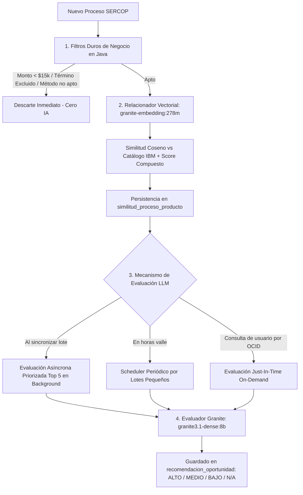

# Arquitectura del Flujo de Detección y Evaluación de Oportunidades IBM

Este documento resume de manera concisa el flujo interno del microservicio para identificar, filtrar y evaluar licitaciones públicas de **SERCOP** como oportunidades de negocio para **IBM**.

---

## 1. Diagrama del Flujo de Trabajo

---

## 2. Componentes y Responsabilidades

### A. Validador de Alcance y Negocio ([`ValidadorAlcanceIbmService.java`](src/main/java/com/ibm/opportunity_analysis_service/application/service/ValidadorAlcanceIbmService.java))
* **Filtros duros:** Elimina procesos de micro-escala (< $15,000 USD) o con palabras clave excluidas (*cableado, tóner, soporte PC, internet ISP*).
* **Confirmación enterprise:** Detecta términos corporativos (*OpenShift, Cloud, IA, SIEM, Observabilidad, Maximo, Storage*) y aplica un bonus de alcance.

### B. Relacionador Matemático ([`AnalizarSimilitudService.java`](src/main/java/com/ibm/opportunity_analysis_service/application/service/AnalizarSimilitudService.java))
* Usa `granite-embedding:278m` para vectorizar el pliego y calcular la similitud coseno contra el catálogo de productos IBM.
* Calcula el score compuesto ponderado:
  $$\text{Score Compuesto} = (\text{Similitud Vectorial} \times 0.70) + \text{Bonus Monto} + \text{Bonus Método} + \text{Bonus Alcance}$$

### C. Evaluador LLM con Guardrails ([`OllamaEvaluadorOportunidadAdapter.java`](src/main/java/com/ibm/opportunity_analysis_service/adapter/out/granite/OllamaEvaluadorOportunidadAdapter.java))
* **Modelo:** `granite3.1-dense:8b` vía Ollama.
* **Control de Carga:** Semáforo de concurrencia (`Semaphore(1)`), `num_predict: 350`, timeout HTTP de 90s y fallback determinista.
* **Criterio:** Recibe el pliego completo y los Top candidatos IBM preseleccionados por los embeddings para calificar viabilidad real (`ALTO`, `MEDIO`, `BAJO`, `N/A`), justificación técnica y estrategia comercial.

### D. Estrategia Híbrida de Ejecución
1. **Reactiva Priorizada:** Al sincronizar nuevos procesos, se evalúan asíncronamente en segundo plano los **Top 5 más calientes**.
2. **Scheduler Periódico:** Un cron en background procesa de forma continua lotes pequeños (3 procesos cada 5 min).
3. **On-Demand Just-In-Time:** Si el usuario solicita un OCID puntual no evaluado, se analiza de inmediato en ~2 segundos.
