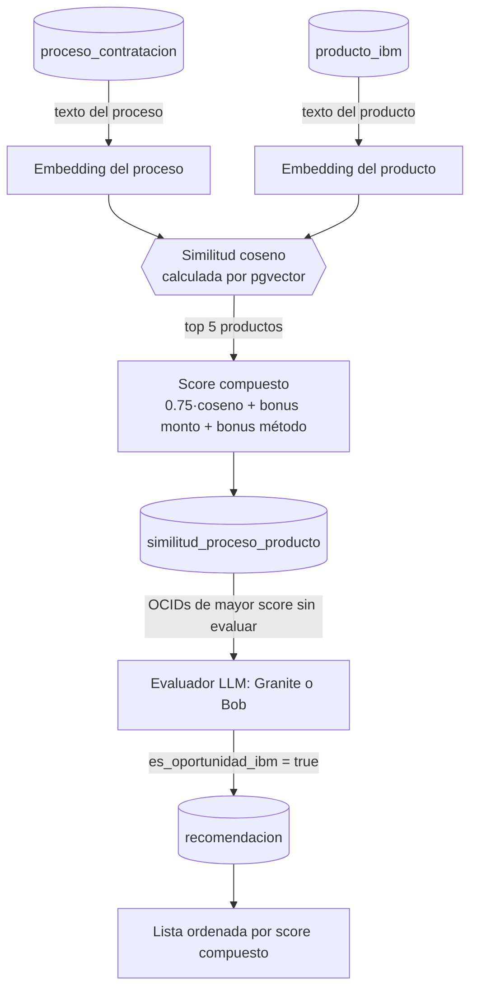

# Relacionamiento SERCOP → Oportunidad IBM

Explica cómo el servicio decide qué productos IBM se parecen a un proceso de contratación de SERCOP, cómo se calculan los scores y cómo se llega a una oportunidad recomendada. Complementa a [`README.md`](README.md) (visión general y switch Bob/Granite).

## Pipeline completo



| Etapa | Servicio | Entrada → Salida |
|---|---|---|
| 1. Embedding de productos | [`GenerarEmbeddingProductosIbmService`](src/main/java/com/ibm/opportunity_analysis_service/application/service/GenerarEmbeddingProductosIbmService.java:29) | Producto → vector |
| 2. Embedding de procesos | [`GenerarEmbeddingCandidatoService`](src/main/java/com/ibm/opportunity_analysis_service/application/service/GenerarEmbeddingCandidatoService.java:63) | Proceso → vector |
| 3. Similitud + score compuesto | [`AnalizarSimilitudService`](src/main/java/com/ibm/opportunity_analysis_service/application/service/AnalizarSimilitudService.java:46) | Vectores → top 5 productos por proceso |
| 4. Evaluación y recomendación | [`RecomendarOportunidadesService`](src/main/java/com/ibm/opportunity_analysis_service/application/service/RecomendarOportunidadesService.java:68) | Candidatos → oportunidad sí/no, producto, confianza |

---

## 1. Qué texto se vectoriza

Los embeddings los genera `granite-embedding:278m` vía Ollama (`POST /api/embed`, ver [`OllamaEmbeddingAdapter`](src/main/java/com/ibm/opportunity_analysis_service/adapter/out/granite/OllamaEmbeddingAdapter.java:28)). Cada lado se convierte primero a un texto estructurado.

**Proceso SERCOP** ([`generarTextoEmbedding`](src/main/java/com/ibm/opportunity_analysis_service/application/service/GenerarEmbeddingCandidatoService.java:109)):

```
Licitación: {titulo}. Requerimiento: {descripcion}. Categoria: {tipoInterno}.
```

**Producto IBM** ([`construirTextoEmbedding`](src/main/java/com/ibm/opportunity_analysis_service/application/service/GenerarEmbeddingProductosIbmService.java:61)):

```
Producto: {nombre}. Descripcion: ... Categorias: ... Capacidades: ... Casos de uso: ...
Tecnologias: ... Palabras clave: ...
```

Los campos vacíos se omiten.

| | Procesos | Productos |
|---|---|---|
| Incremental | Sí: si el texto no cambió y ya hay vector, se omite | No: se vuelven a generar todos en cada ejecución |
| Clave de upsert | `ocid` + modelo | `producto_ibm_id` + modelo |

---

## 2. Similitud coseno

La similitud se calcula **dentro de PostgreSQL** con `pgvector`, no en Java. Una sola consulta en [`buscarPorSimilitudCoseno`](src/main/java/com/ibm/opportunity_analysis_service/adapter/out/persistence/repository/EmbeddingProductoIbmJpaRepository.java:28) compara el vector del proceso contra **todos** los productos y devuelve los mejores `limite` (5 en `AnalizarSimilitudService`).

```sql
SELECT p.id, p.nombre,
       (1 - (e.embedding <=> CAST(:embedding AS vector))) AS similitud
FROM embedding_producto_ibm e
JOIN producto_ibm p ON p.id = e.producto_ibm_id
ORDER BY similitud DESC
LIMIT :limite
```

- `<=>` es el operador de distancia coseno de `pgvector`. Restarlo a 1 lo convierte en similitud: 1 = misma dirección, 0 = ortogonal.
- Captura significado aunque las palabras no coincidan (por ejemplo "gestión documental" y "ECM").
- El código Java solo convierte el `float[]` al formato texto `[0.12,0.03,...]` ([`convertirVector`](src/main/java/com/ibm/opportunity_analysis_service/adapter/out/persistence/adapter/EmbeddingProductoIbmPersistenceAdapter.java:88)) y lee el resultado.
- No existe cálculo de coseno en Java: se eliminó `CalcularSimilitudService`, que lo implementaba pero ninguna clase usaba.

### Intento descartado: búsqueda híbrida con señal léxica

Se implementó una versión híbrida que combinaba el coseno con una señal léxica de búsqueda de texto completo de PostgreSQL:

```
scoreHibrido = 0.65 · coseno + 0.35 · ts_rank_cd(to_tsvector('spanish', producto), plainto_tsquery('spanish', proceso))
```

La idea era capturar coincidencias exactas de siglas y nombres (API, BPM, Db2, Cloud Pak) que un embedding puede diluir. **No dio los resultados esperados y se eliminó del código.**

**Qué falló.** `plainto_tsquery` une todos los términos con AND. El texto de consulta era `titulo + descripcion + tipoInterno`, así que el producto tendría que contener todas esas palabras a la vez.

**Medición** (200 procesos × todos los productos del catálogo = 20 800 pares, ejecutada contra `sercop_db`):

| Consulta léxica | Pares con señal > 0 | Procesos con señal > 0 | Máximo |
|---|---|---|---|
| `plainto_tsquery` con título + descripción + categoría (la que estaba en el código) | 0 de 20 800 | 0 de 200 | 0 |
| `plainto_tsquery` solo con el título | 0 de 20 800 | 0 de 200 | 0 |
| Términos unidos con OR (prueba alternativa, no estuvo en el código) | 10 965 de 20 800 (53 %) | no medido | 1.8 |

**Consecuencias:**
- En la práctica el score híbrido era `0.65 · coseno + 0`. La señal léxica nunca se activó, por lo que la fórmula 65/35 no se cumplía.
- Con OR sí se activa, pero `ts_rank_cd` no está acotado (máximo 1.8) y un 53 % de pares con coincidencia indica que muchos productos comparten palabras genéricas. Habría aportado ruido sin garantía de mejorar el top 5.
- Costo adicional: `to_tsvector` se recalculaba por producto en cada consulta (no había columna `tsvector` ni índice GIN).

**Decisión.** Se eliminó el componente léxico y la consulta usa solo el coseno. Ya no existen el parámetro `textoConsulta` ni `construirTextoBusqueda`.

**Si se quisiera retomar,** habría que: usar OR entre términos, normalizar el rango (por ejemplo `ts_rank_cd(..., 32)`), crear una columna `tsvector` con índice GIN y validar con casos reales que el top 5 mejora.

> Nota: la medición se hizo sobre una muestra de 200 procesos (`LIMIT 200`), no sobre toda la tabla.

---

## 3. Score compuesto

Después de la búsqueda, cada uno de los 5 productos recibe un score que suma señales de negocio ([`calcularScoreCompuesto`](src/main/java/com/ibm/opportunity_analysis_service/application/service/AnalizarSimilitudService.java:134)):

```
scoreCompuesto = 0.75 · coseno + bonusMonto + bonusMétodo
```

| Componente | Regla | Rango |
|---|---|---|
| `coseno` | Resultado de la sección 2 | ~0 – 1 |
| [`bonusMonto`](src/main/java/com/ibm/opportunity_analysis_service/application/service/AnalizarSimilitudService.java:108) | `min(monto / 10 000 000, 1) × 0.15`. Usa `monto`; si es nulo, `presupuesto`. Nulo o ≤ 0 da 0 | 0 – 0.15 |
| [`bonusMétodo`](src/main/java/com/ibm/opportunity_analysis_service/application/service/AnalizarSimilitudService.java:121) | `open` = 0.10, `direct` = 0.03, otro valor = 0.05, nulo = 0 | 0 – 0.10 |

El tope aproximado del bonus es 0.25. La relevancia semántica domina, pero un proceso grande y de licitación abierta sube sobre uno pequeño de contratación directa.

### Ejemplo

Proceso de 2.5 M USD, método `open`, producto con coseno 0.80:

```
bonusMonto      = (2.5M / 10M) · 0.15   = 0.0375
bonusMétodo     = 0.10
scoreCompuesto  = 0.75·0.80 + 0.0375 + 0.10 = 0.7375
```

### Qué se guarda

Una fila por par proceso–producto en `similitud_proceso_producto` (único por `ocid` + `producto_ibm_id`):

| Columna | Contenido |
|---|---|
| `score_vectorial` | Similitud coseno del producto |
| `score_compuesto` | El score de la fórmula anterior |
| `hash_contenido` | SHA-256 de `titulo \| descripcion \| tipoInterno \| monto \| metodo` |

### Ejecución incremental

Si el hash guardado coincide con el actual, el proceso se omite ([`calcularHash`](src/main/java/com/ibm/opportunity_analysis_service/application/service/AnalizarSimilitudService.java:143)). Consecuencias:

- Si cambia el **catálogo IBM**, el hash no cambia y no se recalcula nada. Hay que borrar las filas de `similitud_proceso_producto` (o los hashes) para forzarlo.
- El guardado es un upsert: si un recálculo cambia los 5 mejores, las filas de productos que salieron del top **no se eliminan**.
- Las filas guardadas **antes** de quitar la señal léxica contienen scores híbridos antiguos (equivalentes a `0.65 · coseno`). Como el hash no cambió, no se recalculan solas. No hace falta borrar nada: se verificó que las filas existentes valen exactamente `0.65 · coseno`, así que se reescalan con un `UPDATE` (una sola vez): `score_vectorial = score_vectorial / 0.65` y `score_compuesto = score_compuesto + 0.75 · score_vectorial · (1/0.65 − 1)`, y luego `recomendacion.score_compuesto` = máximo de `score_compuesto` de su proceso. El top 5 de cada proceso no cambia.

---

## 4. De la similitud a la oportunidad

### Qué se evalúa primero

[`findSiguientesAEvaluar`](src/main/java/com/ibm/opportunity_analysis_service/adapter/out/persistence/repository/SimilitudProcesoProductoJpaRepository.java:44) toma los OCIDs sin recomendación, ordenados por el **máximo** `score_compuesto` de sus productos. Los procesos con más relevancia, monto y competitividad se evalúan antes.

### Qué ve el evaluador

Para cada OCID se pasan al evaluador el proceso y los productos candidatos (hasta 5, leídos de `similitud_proceso_producto`) con nombre, descripción, capacidades y tecnologías. Solo en el cálculo on-demand, cuando no hay similitudes guardadas, se limita a 3. Ver [`generarYPersistirRecomendacion`](src/main/java/com/ibm/opportunity_analysis_service/application/service/RecomendarOportunidadesService.java:122).

El evaluador (Granite o Bob, ver [`README.md`](README.md)) devuelve:

| Campo | Valores |
|---|---|
| `es_oportunidad_ibm` | `true` / `false` |
| `producto_recomendado` | Nombre del producto o `null` |
| `nivel_confianza` | `ALTO`, `MEDIO`, `BAJO`, `N/A` |
| `justificacion`, `estrategia_comercial` | Texto libre |

Reglas del prompt:
- Productos commodity de terceros (Microsoft 365, Office, Windows, antivirus genérico, firewalls físicos Fortinet/Palo Alto) dan `false` y `N/A`, y se descartan.
- Desarrollo, BPM, integración, gobierno de datos, IA, nube híbrida, APIs o gestión de ciclo de vida con producto IBM aplicable dan `true` con confianza `ALTO` o `MEDIO`.

La frontera entre ALTO y MEDIO la decide el modelo; no hay umbral numérico en el código.

### Cómo se ordena la lista final

[`findOportunidadesIbm`](src/main/java/com/ibm/opportunity_analysis_service/adapter/out/persistence/repository/RecomendacionJpaRepository.java:25) devuelve solo filas con `es_oportunidad_ibm = true`, ordenadas por `score_compuesto DESC`, con `LIMIT/OFFSET`. Al guardar la recomendación se conserva el máximo `score_compuesto` del proceso.

La confianza ALTO/MEDIO **no interviene en el orden**: un MEDIO con score compuesto alto aparece antes que un ALTO con score menor.

### Evaluación perezosa y caché

1. `GET /recomendaciones?limit=6&offset=N` lee de `recomendacion`.
2. Si faltan resultados, evalúa `limit × 3` OCIDs pendientes. El margen existe porque muchos se descartan.
3. Se guardan también los descartados (`false`), así no se reevalúan.
4. Una recomendación ya generada no se recalcula aunque cambien las similitudes o el catálogo.

---

## 5. Campos del proceso y su uso

| Campo de `proceso_contratacion` | Dónde influye |
|---|---|
| `titulo`, `descripcion`, `tipo_interno` | Embedding del proceso, hash, prompt del evaluador |
| `monto` / `presupuesto` | Bonus de monto, hash, monto mostrado en la recomendación |
| `metodo` | Bonus de método, hash |
| `comprador` | Se muestra en la recomendación |
| `region` | Solo aparece en el prompt de Bob |
| `ocid` | Clave que enlaza embeddings, similitudes y recomendaciones |

---

## 6. Orden de ejecución tras ingestar nuevos procesos

1. `generar_embeddings_candidatos` (solo vectoriza los nuevos o modificados).
2. `analizar_similitud` (salta los procesos con hash sin cambios).
3. `obtener_todas_las_recomendaciones` (evalúa bajo demanda lo que falte).

Si el catálogo IBM cambió: `cargar_catalogo_ibm`, luego `generar_embeddings_productos_ibm`, luego limpiar `similitud_proceso_producto` y `recomendacion`, y repetir los pasos anteriores.
